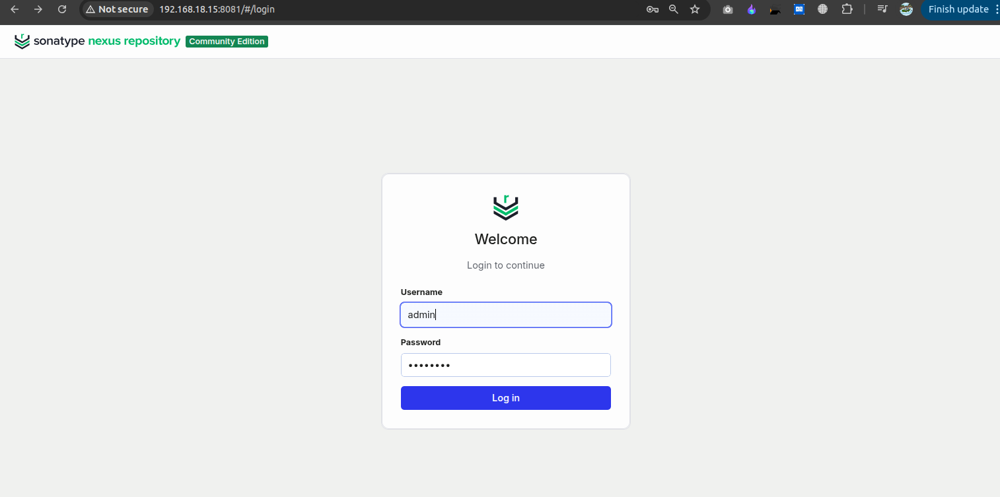
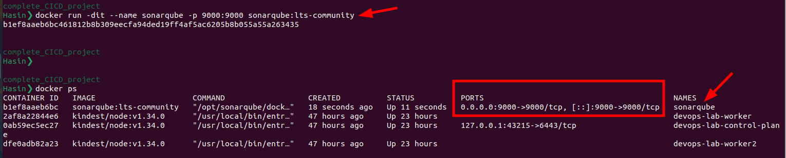
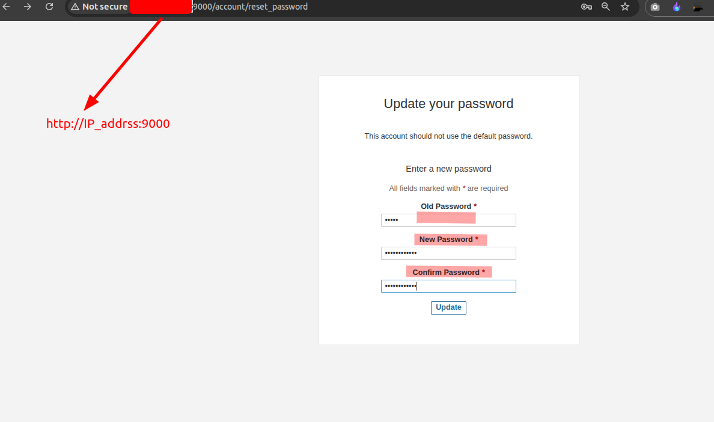
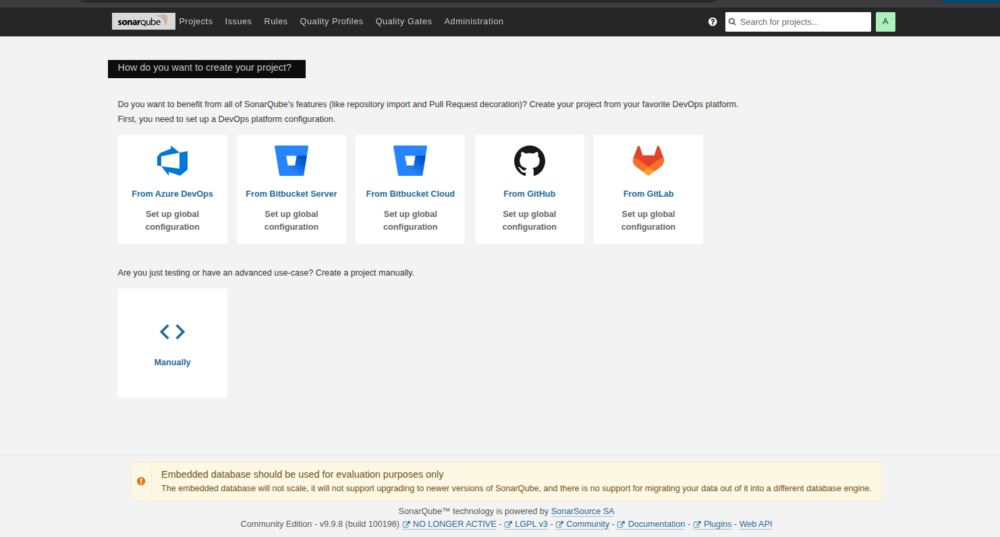
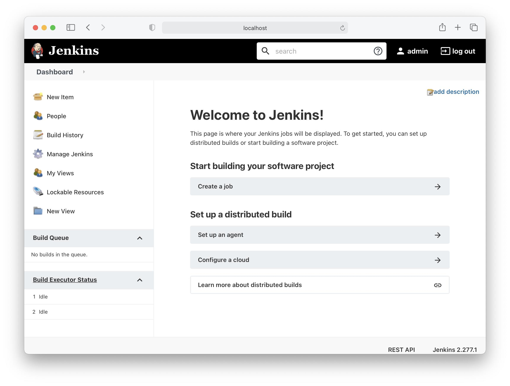

# Enterprise DevSecOps CI/CD Pipeline

An end-to-end Enterprise DevSecOps project that automates application building, testing, security scanning, artifact management, Kubernetes deployment, monitoring, and email notifications using industry-standard DevOps tools.

## Technologies Used

- **Jenkins** – CI/CD Automation
- **Docker** – Containerization
- **Kubernetes** – Container Orchestration
- **SonarQube** – Code Quality Analysis
- **Nexus** – Artifact Management
- **Trivy** – Vulnerability Scanning
- **Prometheus** – Monitoring
- **Grafana** – Monitoring Dashboards
- **Email Notification** – Automated Pipeline Status Notifications


# Kubernetes Installation Commands

### 1. Update System
```bash
sudo apt-get update
sudo apt-get upgrade -y
```

### 2. Install Docker
```bash
sudo apt-get install docker.io -y
sudo systemctl enable docker
sudo systemctl start docker
```

### 3. Install Dependencies
```bash
sudo apt-get install -y apt-transport-https ca-certificates curl gpg
sudo mkdir -p -m 755 /etc/apt/keyrings
```

### 4. Add Kubernetes Repository
```bash
curl -fsSL https://pkgs.k8s.io/core:/stable:/v1.28/deb/Release.key | sudo gpg --dearmor -o /etc/apt/keyrings/kubernetes-apt-keyring.gpg

echo 'deb [signed-by=/etc/apt/keyrings/kubernetes-apt-keyring.gpg] https://pkgs.k8s.io/core:/stable:/v1.28/deb/ /' | sudo tee /etc/apt/sources.list.d/kubernetes.list

sudo apt-get update
```

### 5. Install Kubernetes Components
```bash
sudo apt-get install -y kubeadm=1.28.1-1.1 kubelet=1.28.1-1.1 kubectl=1.28.1-1.1

sudo apt-mark hold kubeadm kubelet kubectl
```

### 6. Initialize Kubernetes Cluster
```bash
sudo kubeadm init --pod-network-cidr=10.244.0.0/16
```

### 7. Configure kubectl
```bash
mkdir -p $HOME/.kube

sudo cp -i /etc/kubernetes/admin.conf $HOME/.kube/config

sudo chown $(id -u):$(id -g) $HOME/.kube/config
```

### 8. Verify Installation
```bash
kubectl cluster-info
kubectl get nodes
kubectl get pods -A
```
====================================


## Sonatype Nexus Repository Setup Using Docker


### 1. Run Nexus Container

```bash
docker run -d \
  --name nexus \
  -p 8081:8081 \
  sonatype/nexus3
```

### 2. Verify Container

```bash
docker ps
```
[nexus setup](./images/nexus_setup.png!)

### 3. Get Admin Password

```bash
docker exec nexus cat /nexus-data/admin.password
```

### 4. Access Nexus

Open in your browser:

```text
http://YOUR_SERVER_IP:8081
```

**Login Credentials:**
- Username: `admin`
- Password: Generated password from Step 3.


===========================================

## SonarQube Setup Using Docker

### 1. Pull SonarQube Image

```bash
docker pull sonarqube:lts-community
```


### 2. Run SonarQube Container

```bash
docker run -d \
  --name sonarqube \
  -p 9000:9000 \
  sonarqube:lts-community
```

### 3. Verify Container

```bash
docker ps
```



### 4. Access SonarQube

Open in your browser:

```text
http://YOUR_SERVER_IP:9000
```

**Default Login:**
- Username: `admin`
- Password: `admin`

Change the password after your first login.

### SonarQube Dashbaord


=================================================

## Jenkins Setup 

## Jenkins Setup on Ubuntu

### 1. Install Java

```bash
sudo apt update
sudo apt install -y fontconfig openjdk-21-jre
java -version
```

### 2. Add Jenkins Repository

```bash
sudo wget -O /etc/apt/keyrings/jenkins-keyring.asc \
https://pkg.jenkins.io/debian-stable/jenkins.io-2026.key

echo "deb [signed-by=/etc/apt/keyrings/jenkins-keyring.asc]" \
https://pkg.jenkins.io/debian-stable binary/ | \
sudo tee /etc/apt/sources.list.d/jenkins.list > /dev/null
```

### 3. Install Jenkins

```bash
sudo apt update
sudo apt install -y jenkins
```

### 4. Start Jenkins Service

```bash
sudo systemctl enable jenkins
sudo systemctl start jenkins
sudo systemctl status jenkins
```

### 5. Get Initial Admin Password


```bash
sudo cat /var/lib/jenkins/secrets/initialAdminPassword
```

### 6. Access Jenkins Dashboard

Open your browser:

```text
http://YOUR_SERVER_IP:8080
```

Enter the initial admin password, install suggested plugins, and create your administrator account.

### Jenkins Dashboard


