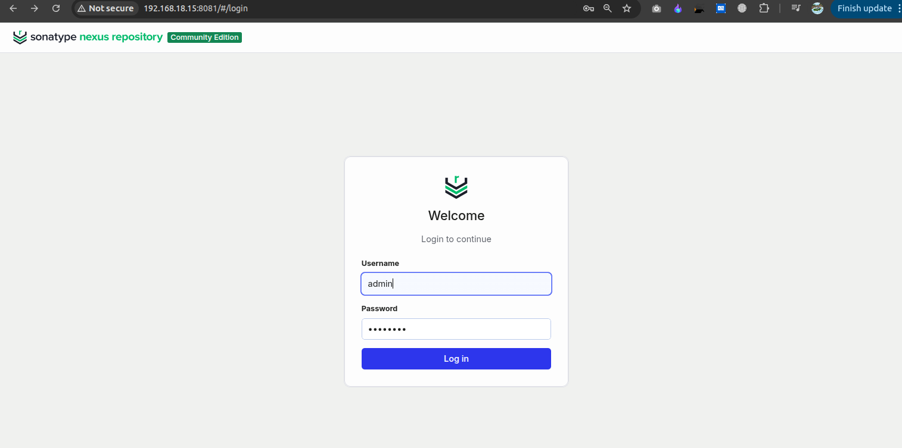
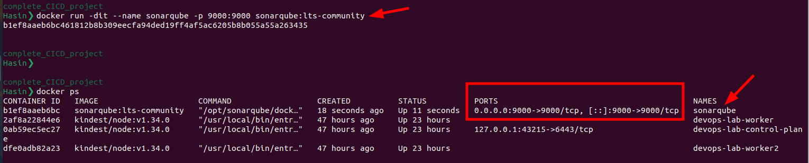
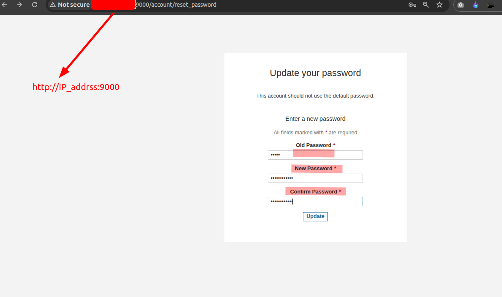
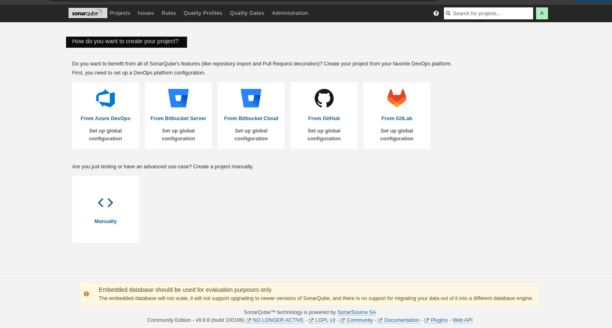
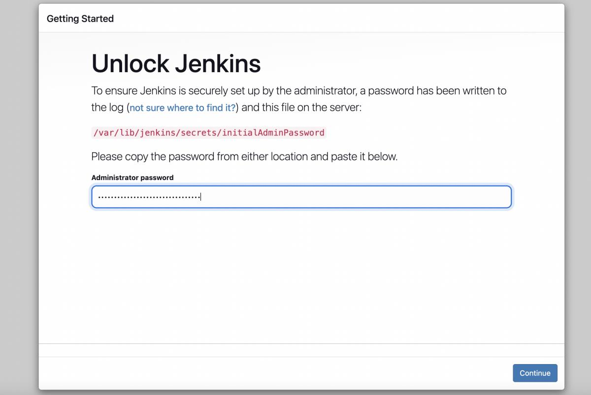
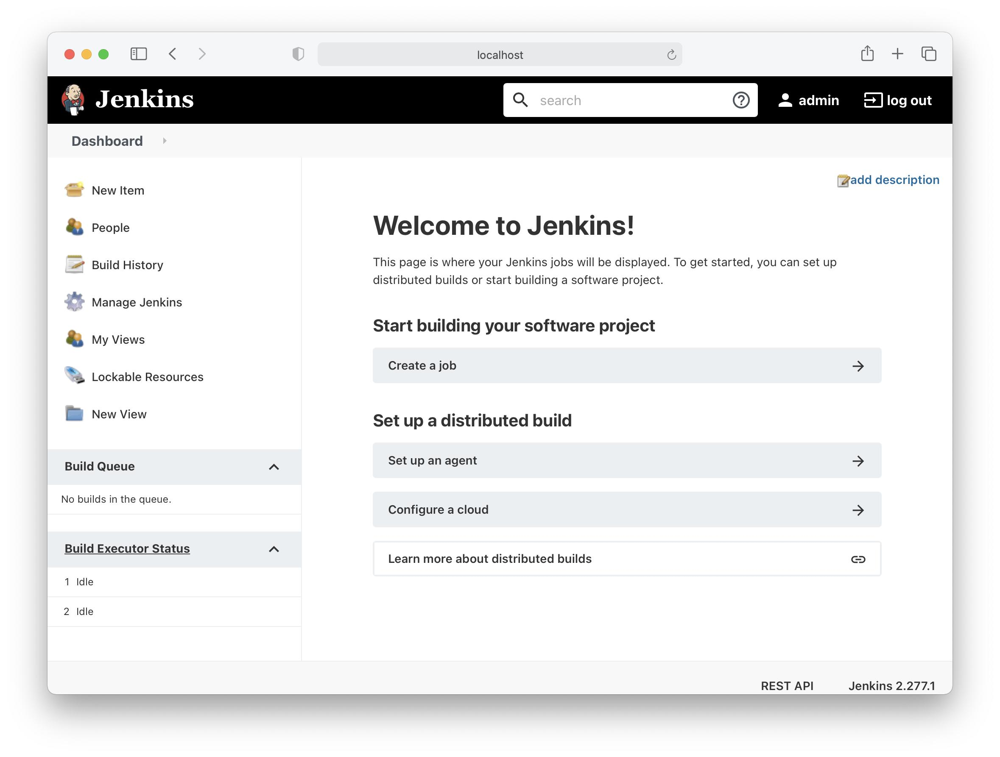

# Enterprise DevSecOps CI/CD Pipeline

An end-to-end Enterprise DevSecOps project that automates application building, testing, security scanning, artifact management, Kubernetes deployment, monitoring, and email notifications using industry-standard DevOps tools.

## Technologies Used

- **Jenkins** – CI/CD Automation
- **Docker** – Containerization
- **Kubernetes** – Container Orchestration
- **SonarQube** – Code Quality Analysis
- **Nexus** – Artifact Management
- **Trivy** – Vulnerability Scanning
- **Prometheus** – Monitoring
- **Grafana** – Monitoring Dashboards
- **Email Notification** – Automated Pipeline Status Notifications


# Kubernetes Installation Commands

### 1. Update System
```bash
sudo apt-get update
sudo apt-get upgrade -y
```

### 2. Install Docker
```bash
sudo apt-get install docker.io -y
sudo systemctl enable docker
sudo systemctl start docker
```

### 3. Install Dependencies
```bash
sudo apt-get install -y apt-transport-https ca-certificates curl gpg
sudo mkdir -p -m 755 /etc/apt/keyrings
```

### 4. Add Kubernetes Repository
```bash
curl -fsSL https://pkgs.k8s.io/core:/stable:/v1.28/deb/Release.key | sudo gpg --dearmor -o /etc/apt/keyrings/kubernetes-apt-keyring.gpg

echo 'deb [signed-by=/etc/apt/keyrings/kubernetes-apt-keyring.gpg] https://pkgs.k8s.io/core:/stable:/v1.28/deb/ /' | sudo tee /etc/apt/sources.list.d/kubernetes.list

sudo apt-get update
```

### 5. Install Kubernetes Components
```bash
sudo apt-get install -y kubeadm=1.28.1-1.1 kubelet=1.28.1-1.1 kubectl=1.28.1-1.1

sudo apt-mark hold kubeadm kubelet kubectl
```

### 6. Initialize Kubernetes Cluster
```bash
sudo kubeadm init --pod-network-cidr=10.244.0.0/16
```

### 7. Configure kubectl
```bash
mkdir -p $HOME/.kube

sudo cp -i /etc/kubernetes/admin.conf $HOME/.kube/config

sudo chown $(id -u):$(id -g) $HOME/.kube/config
```

### 8. Verify Installation
```bash
kubectl cluster-info
kubectl get nodes
kubectl get pods -A
```
====================================


## Sonatype Nexus Repository Setup Using Docker


### 1. Run Nexus Container

```bash
docker run -d \
  --name nexus \
  -p 8081:8081 \
  sonatype/nexus3
```

### 2. Verify Container

```bash
docker ps
```
[nexus setup](./images/nexus_setup.png!)

### 3. Get Admin Password

```bash
docker exec nexus cat /nexus-data/admin.password
```

### 4. Access Nexus

Open in your browser:

```text
http://YOUR_SERVER_IP:8081
```

**Login Credentials:**
- Username: `admin`
- Password: Generated password from Step 3.


===========================================

## SonarQube Setup Using Docker

### 1. Pull SonarQube Image

```bash
docker pull sonarqube:lts-community
```


### 2. Run SonarQube Container

```bash
docker run -d \
  --name sonarqube \
  -p 9000:9000 \
  sonarqube:lts-community
```

### 3. Verify Container

```bash
docker ps
```



### 4. Access SonarQube

Open in your browser:

```text
http://YOUR_SERVER_IP:9000
```

**Default Login:**
- Username: `admin`
- Password: `admin`

Change the password after your first login.

### SonarQube Dashbaord


=================================================
## Trivy Installation

Trivy is a security scanner used to detect vulnerabilities in Docker images, dependencies, and file systems.

### Install Trivy on Ubuntu

```bash
sudo apt-get install wget gnupg -y

wget -qO - https://aquasecurity.github.io/trivy-repo/deb/public.key | gpg --dearmor | sudo tee /usr/share/keyrings/trivy.gpg > /dev/null

echo "deb [signed-by=/usr/share/keyrings/trivy.gpg] https://aquasecurity.github.io/trivy-repo/deb generic main" | sudo tee -a /etc/apt/sources.list.d/trivy.list

sudo apt-get update

sudo apt-get install trivy -y
```

### Verify Trivy Installation

```bash
trivy --version
```

### Official Documentation

[Trivy Official Installation Guide](https://www.trivy.dev/docs/latest/getting-started/installation/)

---
============================

## Jenkins Setup 

## Jenkins Setup on Ubuntu

### 1. Install Java

```bash
sudo apt update
sudo apt install -y fontconfig openjdk-21-jre
java -version
```

### 2. Add Jenkins Repository

```bash
sudo wget -O /etc/apt/keyrings/jenkins-keyring.asc \
https://pkg.jenkins.io/debian-stable/jenkins.io-2026.key

echo "deb [signed-by=/etc/apt/keyrings/jenkins-keyring.asc]" \
https://pkg.jenkins.io/debian-stable binary/ | \
sudo tee /etc/apt/sources.list.d/jenkins.list > /dev/null
```

### 3. Install Jenkins

```bash
sudo apt update
sudo apt install -y jenkins
```

### 4. Start Jenkins Service

```bash
sudo systemctl enable jenkins
sudo systemctl start jenkins
sudo systemctl status jenkins
```

### 5. Get Initial Admin Password


```bash
sudo cat /var/lib/jenkins/secrets/initialAdminPassword
```

## 6. Access Jenkins Dashboard

Open your browser:

```text
http://YOUR_SERVER_IP:8080
```

Enter the initial admin password, install suggested plugins, and create your administrator account.

## Jenkins Dashboard



## 7: Jenkins Required Plugins

Install the following plugins from **Manage Jenkins → Plugins → Available Plugins**.

| Plugin Name | Purpose |
|---|---|
| Eclipse Temurin Installer (1.5) |   JDK installation and management |
| Config File Provider |   Manage configuration files |
| Kubernetes |   Kubernetes integration |
| Kubernetes CLI |   Execute Kubernetes commands |
| Kubernetes Client API |   Kubernetes API communication |
| Kubernetes Credentials |   Manage Kubernetes credentials |
| Maven integration |

------------
### Add Sonarqube token in Jenkins
1. Open `SonarQube` → `Administration` → `Security` → `Users` → `Tokens`.
2. Generate a `new token` and copy it.
3. Open Jenkins → `Manage Jenkins` → `Credentials`.
4. Click `Global credentials` → `Add Credentials`.
5. Select Kind: `Secret text`.
6. Paste the token into Secret.
7. Set ID: `sonar-token`.
8. Click Create.


## add sonarqube in jenkins 


-------

## 9: Configure Jenkins Tools
Navigate to **Manage Jenkins → Tools** and configure the following tools:

1. **JDK** – Java Development Kit
2. **SonarQube Scanner** – Code quality analysis
3. **Maven** – Build and dependency management
4. **Docker** – Containerization

  Configure the installation paths or automatic installers for each tool as required.

## 10: How to add credential in Jenkins there are the steps


1. Open `SonarQube` → `Administration` → `Configuration` → `Webhooks` → Create and enter your Jenkins webhook URL: `http://YOUR_JENKINS_IP:8080/sonarqube-webhook/`.
2. Set the webhook name to `'Jenkins'` and click Create.
   


## 11. Configure Nexus Maven Release and Snapshot Repositories

1. Open **Nexus Repository Manager → Repositories** and create two Maven hosted repositories:
   - `maven-releases`
   - `maven-snapshots`

2. Add the following configuration inside the `<project>` section of your `pom.xml`:

```xml
<distributionManagement>
    <repository>
        <id>nexus-releases</id>
        <url>http://YOUR_NEXUS_IP:8081/repository/maven-releases/</url>
    </repository>

    <snapshotRepository>
        <id>nexus-snapshots</id>
        <url>http://YOUR_NEXUS_IP:8081/repository/maven-snapshots/</url>
    </snapshotRepository>
</distributionManagement>
```

3. Replace `YOUR_NEXUS_IP` with your actual Nexus server IP address.

   
   

       - `nexus-releases`
       - `nexus-snapshots`

4.  Go to Jenkins → Manage Jenkins → Managed files → Add a new Config → Maven settings.xml.
    Enter ID nexus-settings, add Nexus server IDs (nexus-releases and nexus-snapshots), select their Jenkins credentials, and click Submit/Save.

5. Configure Nexus credentials in Maven's `settings.xml`, using the matching IDs:
   
    Open ~/.m2/settings.xml and add your Nexus username and password inside the <servers> section.
    Set the <id> values to nexus-releases and nexus-snapshots to match the IDs in your pom.xml.
   


## add nexus user and password


=====================


  ## 12. Configure Kubernetes RBAC for Jenkins

Create a dedicated namespace, ServiceAccount, Role, RoleBinding, and Secret to allow Jenkins to deploy applications into Kubernetes.

### 1. Create Namespace

```bash
kubectl create namespace webapps
```

### 2. Create Kubernetes Configuration Files

**Create `svc.yaml` – ServiceAccount**

```yaml
apiVersion: v1
kind: ServiceAccount
metadata:
  name: jenkins
  namespace: webapps
```

**Create `role.yaml` – Role**

```yaml
apiVersion: rbac.authorization.k8s.io/v1
kind: Role
metadata:
  name: app-role
  namespace: webapps
rules:
- apiGroups: ["", "apps"]
  resources: ["pods", "services", "deployments", "replicasets"]
  verbs: ["get", "list", "watch", "create", "update", "patch", "delete"]
```

**Create `bind.yaml` – RoleBinding**

```yaml
apiVersion: rbac.authorization.k8s.io/v1
kind: RoleBinding
metadata:
  name: app-rolebinding
  namespace: webapps
subjects:
- kind: ServiceAccount
  name: jenkins
  namespace: webapps
roleRef:
  kind: Role
  name: app-role
  apiGroup: rbac.authorization.k8s.io
```

**Create `sec.yaml` – Secret**

```yaml
apiVersion: v1
kind: Secret
metadata:
  name: mysecretname
  namespace: webapps
  annotations:
    kubernetes.io/service-account.name: jenkins
type: kubernetes.io/service-account-token
```

Replace the example credentials with your actual values. Never commit real credentials to GitHub.

### 3. Apply Kubernetes Configurations

```bash
kubectl apply -f svc.yaml
kubectl apply -f role.yaml
kubectl apply -f bind.yaml
kubectl apply -f sec.yaml
```

### 4. Verify Kubernetes Resources

```bash
kubectl get serviceaccount -n webapps
kubectl get roles -n webapps
kubectl get rolebindings -n webapps
kubectl get secrets -n webapps
```

**Result:** Jenkins now has a dedicated ServiceAccount and namespace-scoped RBAC permissions for managing application resources in Kubernetes.


## Add Kubernetes Token to Jenkins Credentials

### show cred in on terminal 
1. Retrieve the ServiceAccount token using `kubectl describe secret mysecretname -n webapps` or `kubectl get secret mysecretname -n webapps -o jsonpath='{.data.token}' | base64 --decode`.


3. Go to **Jenkins → Manage Jenkins → Credentials → Global Credentials → Add Credentials**.
4. Select **Secret text**, paste the Kubernetes token into **Secret**, set ID to `k8s-token`, and click **Create**.


==============================


# BoardgameListingWebApp

## Description 

**Board Game Database Full-Stack Web Application.**
This web application displays lists of board games and their reviews. While anyone can view the board game lists and reviews, they are required to log in to add/ edit the board games and their reviews. The 'users' have the authority to add board games to the list and add reviews, and the 'managers' have the authority to edit/ delete the reviews on top of the authorities of users.  

## Technologies

- Java
- Spring Boot
- Amazon Web Services(AWS) EC2
- Thymeleaf
- Thymeleaf Fragments
- HTML5
- CSS
- JavaScript
- Spring MVC
- JDBC
- H2 Database Engine (In-memory)
- JUnit test framework
- Spring Security
- Twitter Bootstrap
- Maven

## Features

- Full-Stack Application
- UI components created with Thymeleaf and styled with Twitter Bootstrap
- Authentication and authorization using Spring Security
  - Authentication by allowing the users to authenticate with a username and password
  - Authorization by granting different permissions based on the roles (non-members, users, and managers)
- Different roles (non-members, users, and managers) with varying levels of permissions
  - Non-members only can see the boardgame lists and reviews
  - Users can add board games and write reviews
  - Managers can edit and delete the reviews
- Deployed the application on AWS EC2
- JUnit test framework for unit testing
- Spring MVC best practices to segregate views, controllers, and database packages
- JDBC for database connectivity and interaction
- CRUD (Create, Read, Update, Delete) operations for managing data in the database
- Schema.sql file to customize the schema and input initial data
- Thymeleaf Fragments to reduce redundancy of repeating HTML elements (head, footer, navigation)

## How to Run

1. Clone the repository
2. Open the project in your IDE of choice
3. Run the application
4. To use initial user data, use the following credentials.
  - username: bugs    |     password: bunny (user role)
  - username: daffy   |     password: duck  (manager role)
5. You can also sign-up as a new user and customize your role to play with the application! 😊


